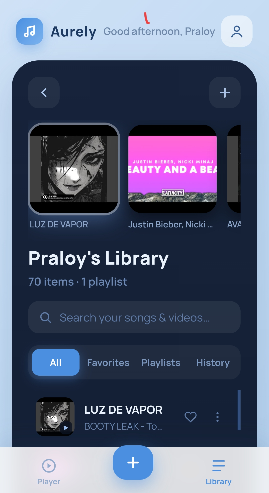

# 🎵 Aurely

A personal music player to organize and enjoy your favorite songs and YouTube videos.

🔗 **Live Website:** https://aurelyplay.vercel.app

## ✨ Features

- 🎧 **Personal Music Library** — Add and organize your favorite songs and videos.
- ▶️ **YouTube Support** — Play music and videos using YouTube links.
- 🎵 **Direct Audio Support** — Add audio files through direct URLs, including MP3, M4A and OGG.
- ❤️ **Favorites** — Keep your favorite tracks easily accessible.
- 📂 **Custom Playlists** — Create and manage your own playlists.
- 🕘 **Listening History** — Keep track of your recently played content.
- ⏭️ **Playback Queue** — Manage what's coming up next.
- 🎚️ **Audio Equalizer** — Customize the sound of supported direct audio tracks.
- 📦 **Import & Export** — Back up and restore your music library.
- 🔒 **Privacy Focused** — Your library and settings are stored locally on your device. No account required.

## 📸 Preview

## 📱 Preview

## 🔐 Privacy First

Aurely is designed to be a personal listening space.

- No account registration required.
- No social sharing features.
- Your library is stored locally on your device.
- Export your library for backup.
- Clear your history or erase your local data whenever you want.

## 🚀 Getting Started

1. Visit [Aurely](https://aurelyplay.vercel.app).
2. Enter your name to personalize your experience.
3. Add a YouTube link or direct audio URL.
4. Organize your tracks into playlists.
5. Enjoy your personal music library!

---

**Made with ❤️ by Aurely
